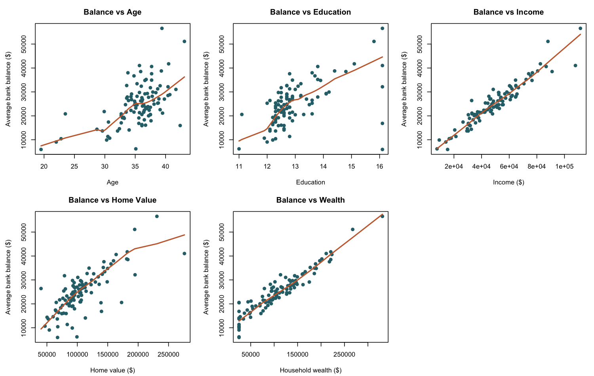
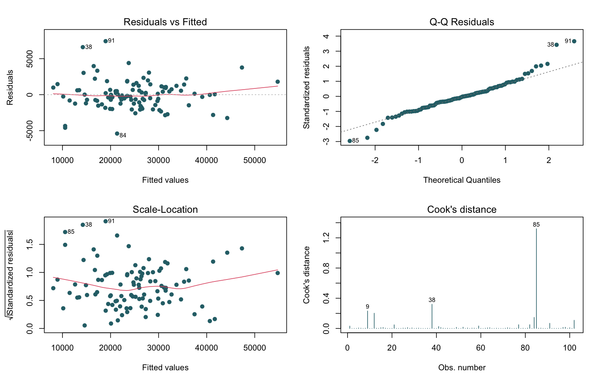
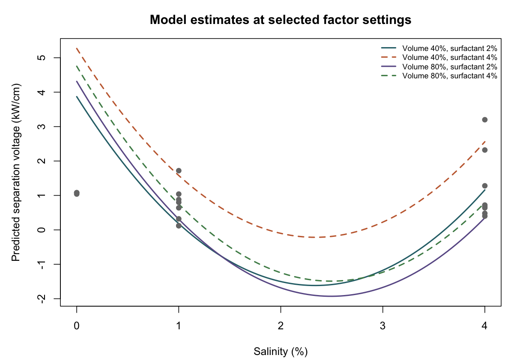
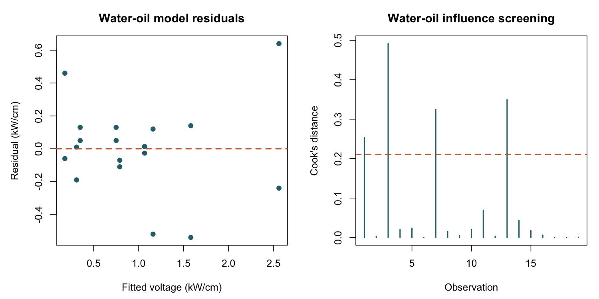

# Applied Regression Case Studies

This project uses linear regression to explore two questions: which market-profile characteristics are associated with average bank balances, and how experimental settings relate to the voltage needed to separate a water-oil emulsion.

## 1. Banking market profiles

### Problem

For 102 market profiles, how does average bank balance vary with median age, education, income, home value, and household wealth? Which of these characteristics help explain balance when considered together, and do any observations or predictor relationships need special care?

This is a descriptive modeling exercise. The records are aggregate profiles, and the analysis can identify associations in this dataset; it cannot establish that a characteristic causes a balance to change.

### Findings

- Average balance has strong positive pairwise correlations with income (*r* = 0.952) and wealth (*r* = 0.949).
- In the full regression, home value is not statistically significant (*p* = 0.372). After removing it, wealth, income, age, and education are significant at the 0.05 level.
- The reduced model's adjusted R² is 0.944, meaning it accounts for 94.4% of the observed variation in balance in this sample. This is an in-sample fit statistic, not a measure of performance on new data.
- Income and wealth are themselves highly correlated (*r* = 0.947), with variance inflation factors above 10 in the reduced model. Their separate regression coefficients may therefore be unstable and should be interpreted cautiously.
- The diagnostic plots flag observations worth checking. Ten rows exceed the common Cook's distance screening value of 4/n; the largest is about 1.32 at row 85. This is a review signal, not a reason to remove records automatically.

### What the plots show



Each point represents one market profile. The orange curve is a local smoother that helps show the broad pattern; it is not the fitted multiple-regression line. Income and wealth show the clearest upward patterns, while the other plots are more dispersed. The panels also make unusually high or low balances visible.



The four panels check different aspects of the reduced model: residuals versus fitted values can reveal curvature; the Q-Q plot checks whether residuals follow a normal pattern; the scale-location plot checks whether residual spread changes across fitted values; and Cook's distance highlights observations that may strongly affect the fit. Several labeled points stand out, so the model should be interpreted with those diagnostics in mind.

## 2. Water-oil separation experiment

### Problem

The experiment measures voltage for 19 water-oil mixtures under different settings. Which factors and combinations of factors are associated with the voltage required to separate the mixture? In particular, does a model with interactions and curvature describe the observed results better than a simple additive relationship?

### Findings

The exploratory model uses volume, salinity, and surfactant concentration, together with volume-by-salinity and volume-by-surfactant interactions and a squared salinity term. Its adjusted R² is 0.801, compared with 0.599 for the additive model using the same three main effects. The selected model's overall F-test *p*-value is 0.000121, and each included term has a *p*-value below 0.05. This is an in-sample comparison, not validation on new experiments.

The interactions mean that the relationship between volume and voltage changes with salinity and surfactant level. The squared salinity term represents curvature. As a result, an individual coefficient should not be read as a constant effect that applies at every setting.

These results are exploratory: several candidate models were considered on the same 19 observations, which can make the selected fit look stronger than it will on new experiments. Some fitted combinations also produce negative voltage estimates, which are physically impossible. The model is useful for describing patterns in these data, but needs further validation before it is used for prediction or process decisions.

### What the plots show



The colored curves show the model's estimated voltage as salinity changes, for four combinations of volume (40% or 80%) and surfactant concentration (2% or 4%). The gray points are the observed experiments, which also vary in other measured factors. The curves show how the selected model represents interaction and curvature; their negative sections expose a limitation of using this polynomial model across the full range.



The left panel compares residuals with fitted voltage; a strong pattern would suggest that the model misses structure. The right panel shows Cook's distance for each observation. The dashed line is the common 4/n screening value. Four observations exceed it, including the largest-influence point at row 3. With only 19 observations, those points deserve attention, but the threshold alone does not determine whether any should be excluded.

## Reproduce the analysis

Install R, then run this from the repository root:

```sh
Rscript analysis.R
```

The script uses base R only. It reads the two files in `data/` and writes the plots in `figures/`.

## Data sources

- `BANKING.csv` contains aggregate market-profile measurements. The supplied file did not include a source citation or reuse terms; confirm that you may redistribute it before sharing the repository publicly.
- `WATEROIL.txt` contains 19 observations from Førdedal, H., Nodland, E., Sjöblom, J., and Kvalheim, O. M. (1995), “A multivariate analysis of W/O emulsions in high external electric fields as studied by means of dielectric time domain spectroscopy,” *Journal of Colloid and Interface Science*, 173(2), 396–405. [Article record and DOI](https://doi.org/10.1006/jcis.1995.1340).
